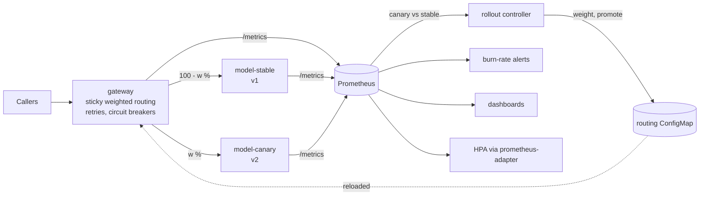

# Highly available model inference platform

[](https://github.com/darshansatpathy/ha-model-inference-platform/actions/workflows/ci.yml)
[](https://github.com/darshansatpathy/ha-model-inference-platform/actions/workflows/codeql.yml)


Serving a model is the easy part. Keeping it answering while pods die, nodes drain, traffic spikes
and a new model version turns out to be worse than the old one is the platform's job. This
repository is that platform, small enough to read and tested the way it would be operated:

- **Canary releases with automated analysis.** A gateway splits traffic by caller; a controller
  moves the canary through 10% → 50% → 100%, compares it with the stable version at every step,
  and rolls it back the moment it is measurably worse.
- **No dropped requests on failure.** Retries on the other backend, circuit breakers, readiness that
  turns off before shutdown, connection draining, PodDisruptionBudgets and `maxUnavailable: 0`.
- **Autoscaling on in-flight requests**, with admission control so overload produces fast 503s
  instead of timeouts.
- **SLOs with burn-rate alerts and dashboards**, generated from one file and unit-tested with `promtool`.
- **Kubernetes manifests** hardened for the `restricted` Pod Security Standard, validated with
  kubeconform, and deployed on kind in CI.

## What the tests prove

| Scenario | Result | Where |
|---|---|---|
| Healthy canary under 200 req/s | promoted through 10/50/100%, **0 failed requests**, stable now v2 | [docs/canary-drills.md](docs/canary-drills.md) |
| Canary failing 3% of requests | **rolled back at 10%**; callers saw 0.41% errors during the step | [docs/canary-drills.md](docs/canary-drills.md) |
| Canary 150 ms slower | **rolled back at 10%** (p95 273 ms against 5 ms) | [docs/canary-drills.md](docs/canary-drills.md) |
| Stable server SIGKILLed under 150 req/s | **0 failed requests** of 600: retried, then circuit opened | `tests/test_drill.py` |
| Fast burn (2% errors, budget 0.1%) | pages within 3 minutes; resolves within 30 minutes of recovery | `slo/tests.yaml` |
| Slow burn (0.4% errors) | opens a ticket, does not page | `slo/tests.yaml` |
| Tampered model artifact | server never becomes ready | `tests/test_model.py`, `tests/test_server.py` |
| On kind: failing canary, healthy canary, rolling restart under load | rolled back; promoted (stable Deployment rolled to v2); **0 failed requests** during the restart | `scripts/e2e-kind.sh` |

From [docs/capacity.md](docs/capacity.md): one server process sustains about 1,300 requests per second
at a p95 of 6 ms with 8 requests in flight; past that, requests only queue. The autoscaler's target
is 8 in-flight requests per pod.

## Architecture



Details, failure handling and the reasoning behind the gateway are in
[docs/architecture.md](docs/architecture.md); decisions in [docs/adr/](docs/adr/); what to do when
an alert fires in [docs/runbooks.md](docs/runbooks.md).

## Quick start

```bash
python -m venv .venv && . .venv/bin/activate
pip install -e ".[dev]"

# Three terminals, or use `ifp drill` below.
ifp serve --port 8081 --version v1
ifp serve --port 8082 --version v2
printf 'stable: {url: http://127.0.0.1:8081}\ncanary: {url: http://127.0.0.1:8082}\ncanary_weight: 0\n' > routing.yaml
ifp gateway --port 8080 --routing-file routing.yaml

ifp load --url http://127.0.0.1:8080 --rate 100 --seconds 600 &      # traffic
ifp rollout --routing-file routing.yaml --gateway http://127.0.0.1:8080 \
  --steps 10,50,100 --step-seconds 20 --min-requests 150             # canary analysis

ifp drill            # all three canary scenarios, end to end
ifp generate --check # rules and dashboards match slo/slo.yaml
```

A prediction:

```bash
curl -s localhost:8080/v1/predict -H 'content-type: application/json' -H 'x-routing-key: alice' \
  -d '{"instances": [{"mean_radius": 14.1, "mean_texture": 19.3, ...}]}'
```

### On Kubernetes

```bash
kubectl apply -k deploy/k8s/overlays/production      # gateway, model servers, HPAs, PDBs, policies
kubectl apply -k deploy/k8s/monitoring               # PodMonitors, PrometheusRule, dashboards
helm install prometheus-adapter prometheus-community/prometheus-adapter \
  -n monitoring -f deploy/k8s/monitoring/prometheus-adapter-values.yaml

# Release v3: point the canary at it, then let the controller roll it out.
kubectl -n inference set env deploy/model-canary MODEL_VERSION=v3
kubectl -n inference delete job rollout --ignore-not-found
kubectl apply -k deploy/k8s/rollout       # or from a workstation: ifp rollout --store configmap --prometheus <url>
```

The production overlay expects the Prometheus Operator, Grafana's dashboard sidecar and
prometheus-adapter; `deploy/k8s/overlays/kind` runs without them.

## Repository layout

| Path | Contents |
|---|---|
| `src/inferplat/` | Server, gateway, rollout controller, SLO and dashboard generators, load and capacity tools, drills, CLI |
| `models/` | Two versioned, digest-verified model artifacts and their provenance |
| `slo/` | Objectives, generated rules, `promtool` rule tests |
| `deploy/k8s/` | Kustomize base, kind and production overlays, rollout Job, monitoring bundle |
| `scripts/e2e-kind.sh` | The end-to-end test run in CI |
| `docs/` | Architecture, runbooks, canary drills, capacity, ADRs |

## Limitations

- The model is deliberately simple; the platform is the subject. Heavier models change the capacity
  numbers and the HPA target, not the mechanisms.
- The drills run every process on one machine; latency figures there are for comparison, not
  production estimates.
- When the stable backend's circuit is open, all traffic goes to the canary regardless of its
  weight: availability is preferred over canary isolation, and the canary alert covers the risk.

## License

MIT. The model training data is CC BY 4.0; see [models/README.md](models/README.md).
