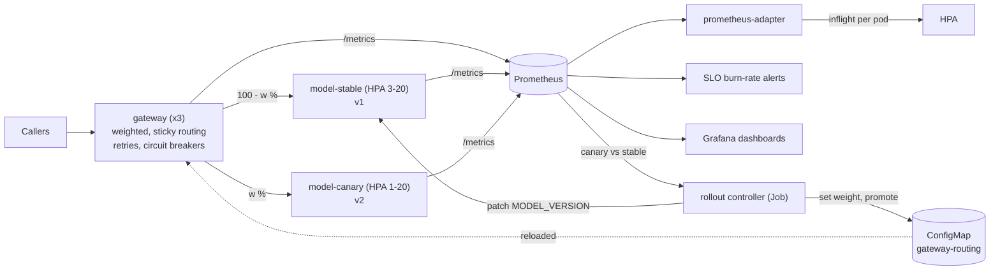

# Architecture

## Components

| Component | What it guarantees |
|---|---|
| Model server (`server.py`) | Serves one verified artifact. Ready only after the digest check, load and warm-up; not ready as soon as shutdown begins; drains in-flight requests. Sheds load with 503 + `Retry-After` beyond `MAX_INFLIGHT` instead of queueing into timeouts. |
| Gateway (`gateway.py`) | Splits traffic by a hash of the routing key, so each caller sees one version during a rollout. Retries once on the other backend when the chosen one is unreachable, times out or sheds load. Opens a backend's circuit after consecutive failures. Reloads routing from the ConfigMap without restarting, and keeps the last good routing if a bad one is written. |
| Rollout controller (`rollout.py`) | Moves the canary through the steps, waits until every gateway reports the new weight, compares canary and stable over the step, extends a step that lacks traffic, rolls back on the first failed step, promotes after the last. |
| SLOs (`slo.py`, `slo/`) | Recording rules and multi-window, multi-burn-rate alerts generated from `slo/slo.yaml`, unit-tested with `promtool test rules`. |
| Dashboards (`dashboards.py`) | Overview and SLO dashboards generated as JSON; every query is parsed by `promtool` in CI. |
| Capacity (`capacity.py`, `loadtest.py`) | Open-loop load, a closed-loop concurrency sweep, the HPA target derived from it. |

## Failure handling

| Failure | What happens |
|---|---|
| A model server pod dies | In-flight requests to it fail at the gateway and are retried on the other backend; its circuit opens; Kubernetes replaces the pod; readiness gates its return. Tested by SIGKILL under load: 0 failed requests. |
| A pod is drained or rolled | `preStop` keeps it serving while endpoints update; readiness turns false; in-flight requests finish; `maxUnavailable: 0` and the PDB keep capacity. Tested in the kind end-to-end run with a rolling restart under load. |
| A canary fails or is slow | The controller rolls it back at the first step where it is measurably worse. Tested by the drills: 3% errors and +150 ms are both rolled back at 10%. |
| A bad routing document is written | The gateway keeps the last good routing and counts `gateway_routing_reload_errors_total`. |
| A tampered artifact | The server never becomes ready; the rollout is stuck at the Deployment level, not serving wrong answers. |
| Overload | Servers shed beyond their limit; the HPA adds pods on in-flight requests; saturation and shedding alerts fire before the latency SLO burns. |
| One zone lost | Production spreads every Deployment across zones (`topologySpreadConstraints`), with three gateways and at least three stable servers. |

## Why the gateway, not a service mesh

Weighted routing could come from Istio, Linkerd or Argo Rollouts. The gateway here is small and
explicit, so the platform runs the same way on a laptop, in CI on kind and in a cluster, and the
rollout logic can be tested without a mesh. The controller's `WeightStore` and `MetricsSource`
interfaces are where a mesh (`VirtualService` weights) or Argo Rollouts would plug in instead.
